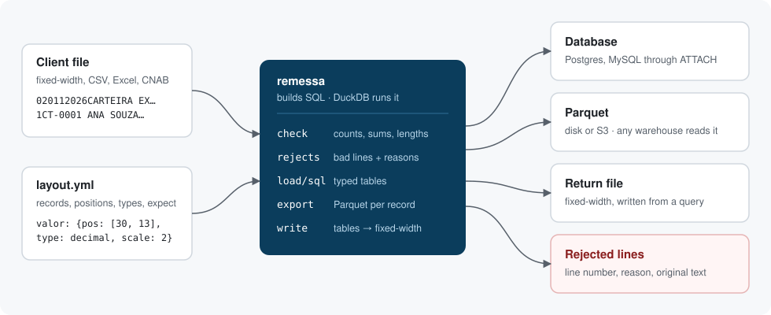

# Workflow: from the client's file to the return file



One script, six steps, a real Postgres in the middle.

```bash
docker compose up -d --wait
python workflow.py
docker compose down
```

| Step | What happens | Call |
|---|---|---|
| 1 | Compare the file with the layout: counts, sums, line lengths, types | `gabarito.check` |
| 2 | Set aside the lines that break it, with the reason | `gabarito.rejects` |
| 3 | Load the typed rows into Postgres | `gabarito.sql` + DuckDB `ATTACH` |
| 4 | Join them with a table that already lives in the database | `postgres_query` |
| 5 | Export the result to Parquet | DuckDB `COPY` |
| 6 | Write the fixed-width return file from a query | `gabarito.write` |

## Input

[`entrada.txt`](entrada.txt), described by [`entrada.yml`](entrada.yml). Line 5 has a letter in the amount.

```
020112026CARTEIRA EXEMPLO
1CT-0001 ANA SOUZA           000000015000020261210
1CT-0002 BRUNO LIMA          000000003299020261215
1CT-0003 CARLA DIAS          000000120000020270105
1CT-0004 DIEGO ROCHA         00000000X500020261220
1CT-0005 ELISA NUNES         000000004805020261228
9000005000000001431040
```

## Output

```
1. check
   detalhe.valor: 1 value(s) do not convert to decimal
2. rejects -> out/rejeitadas.csv
   line 5: detalhe.valor: not a valid decimal
3. load into Postgres
   rows in Postgres: 4
4. query in Postgres (the join runs there, not in DuckDB)
┌──────────┬─────────────┬─────────┬───────────────┬────────────┐
│ contrato │    nome     │ status  │     valor     │ vencimento │
│ varchar  │   varchar   │ varchar │ decimal(18,2) │    date    │
├──────────┼─────────────┼─────────┼───────────────┼────────────┤
│ CT-0001  │ ANA SOUZA   │ ATIVO   │       1500.00 │ 2026-12-10 │
│ CT-0002  │ BRUNO LIMA  │ ATIVO   │        329.90 │ 2026-12-15 │
│ CT-0003  │ CARLA DIAS  │ QUITADO │      12000.00 │ 2027-01-05 │
│ CT-0005  │ ELISA NUNES │ ATIVO   │        480.50 │ 2026-12-28 │
└──────────┴─────────────┴─────────┴───────────────┴────────────┘

5. export -> out/aceitos.parquet
6. write the return file -> out/retorno.txt
   6 lines; check of the file we just wrote: ok
020112026
1CT-0001 ATIVO     0000000150000
1CT-0002 ATIVO     0000000032990
1CT-0003 QUITADO   0000001200000
1CT-0005 ATIVO     0000000048050
9000004000000001431040
```

The return file is described by [`retorno.yml`](retorno.yml). Its trailer carries the count and the total, and the same `check` that validates incoming files validates the one just written.

A value that does not convert is left out of the `sum` rule and reported on its own line, as in step 1.
